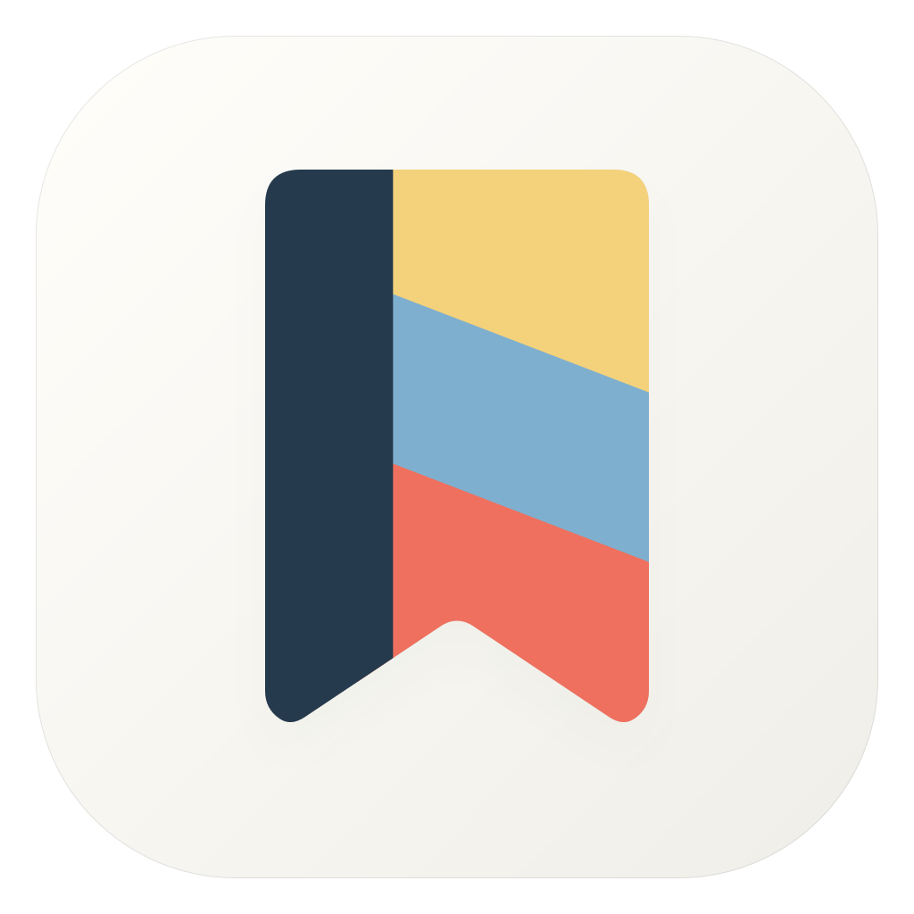
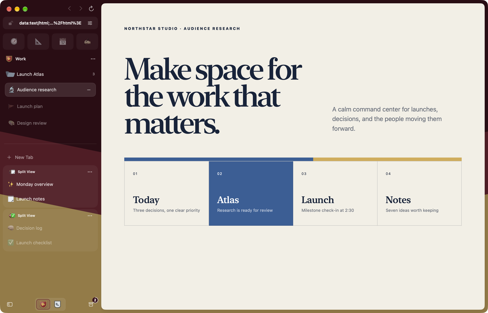
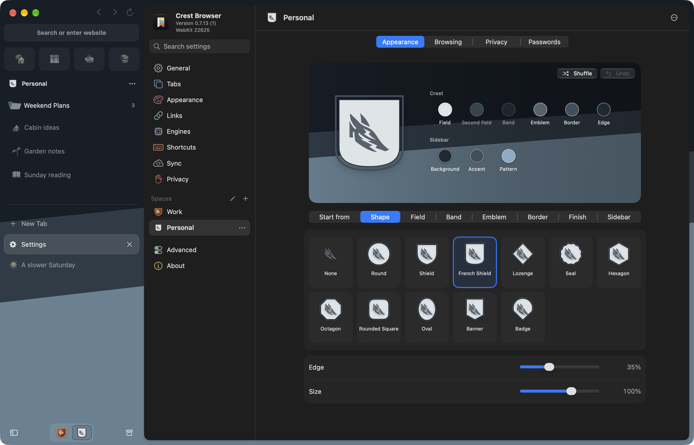
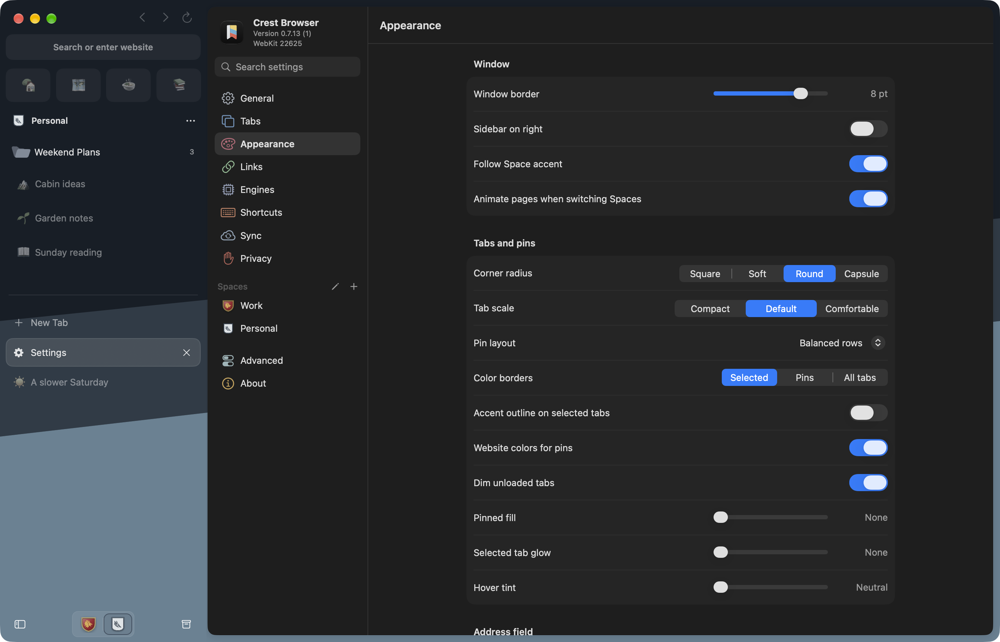
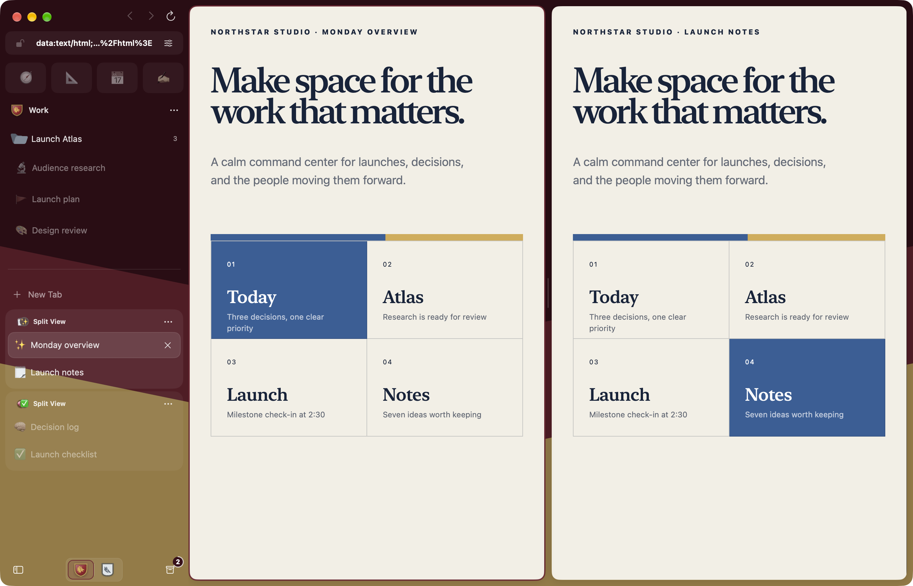
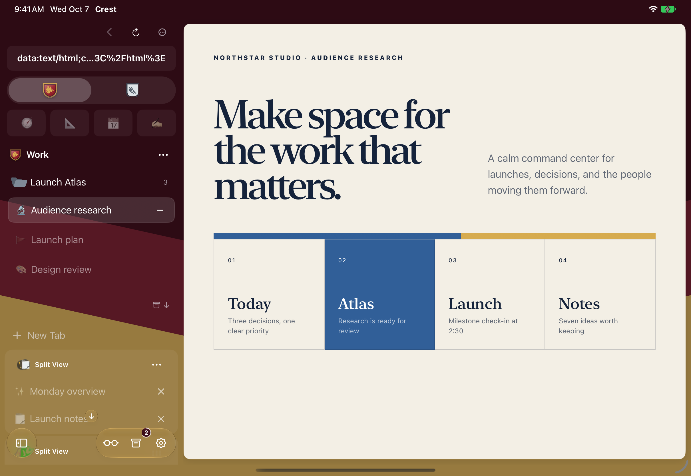
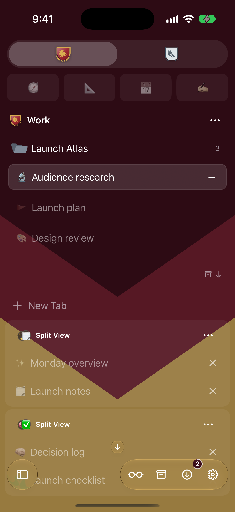

<div align="center">
  
  <h1>Zee</h1>
  <p><strong>An open source browser for Mac, iPhone, and iPad.</strong></p>
  <p>Built with SwiftUI, running Chromium and WebKit on Mac, with separate Spaces for different parts of your life.</p>
  <p>
    <a href="https://github.com/rafaelo96/Zee/actions/workflows/ci.yml"></a>
    <a href="https://github.com/rafaelo96/Zee/releases/latest"></a>
    <a href="LICENSE"></a>
  </p>
  <p>
    <a href="https://rafaelo96.github.io/Zee/"><strong>Visit the product site</strong></a>
    ·
    <a href="https://rafaelo96.github.io/Zee/guides/">Read the guides</a>
    ·
    <a href="https://github.com/rafaelo96/Zee/releases/latest">Download for Mac</a>
    ·
    <a href="Documentation/ROADMAP.md">Roadmap</a>
    ·
    <a href="SUPPORT.md">Support</a>
  </p>
</div>

Browse Mac releases by channel: [Stable](https://github.com/rafaelo96/Zee/releases?q=prerelease%3Afalse),
[Nightly](https://github.com/rafaelo96/Zee/releases?q=prerelease%3Atrue+%22Nightly+builds%22), or
[Development](https://github.com/rafaelo96/Zee/releases?q=prerelease%3Atrue+%22Development+builds%22).

<p align="center">
  <a href="Website/assets/zee-work-mac.png"></a>
</p>

## A browser with boundaries

Most browsers put every login, tab, and distraction into one long-lived container. Zee begins with **Spaces** instead. Give work, home, research, or a private session its own banner; Zee gives each one its own cookies, website data, history, archive, tabs, credentials, settings, and sync identity.

Switching Spaces changes more than the color of the window. It changes the browsing context.

When several Spaces should share one set of sign-ins, make them **Sub-Spaces**: each keeps its own tabs and look while the group shares cookies, history, passwords, and extensions. [Read the Sub-Spaces guide.](https://rafaelo96.github.io/Zee/guides/sub-spaces/)

## Two engines on Mac

Zee for Mac opens pages in **Chromium** by default. Its engine is Chromium
with Zee's privacy changes, which keep your browsing, form and account data
away from Google, and runs Chrome Web Store extensions. Any website or page can
open in **WebKit** instead, which adds Reader, whole-page translation, built-in
content blocking, and FairPlay video. Chromium leaves protected video to
WebKit: Netflix, Disney+, Max and Prime Video open in WebKit, and any other
page that asks for Widevine or PlayReady video, itself or from a frame of its
own site, switches to WebKit automatically, respecting any unsaved-changes
prompt before moving it. Choose the default engine and
per-website rules in **Settings → Engines**. iPhone and iPad use WebKit. The
[engine guide](https://rafaelo96.github.io/Zee/guides/engines/) lists what each engine
supports.

## Badge Studio and Appearance

**Badge Studio** puts each Space's badge on that Space's own sidebar background. Start from a template, then step through shape, field, band, emblem, border, finish and sidebar, choosing from previews of your own badge. Every part of the badge and the sidebar has its own color, named by what it paints. Use heraldic artwork, emoji, monograms, or a searchable SF Symbols picker, and Shuffle and Undo freely.

**Appearance** lets you dock the sidebar on either edge, go borderless, adjust tab shape and scale, choose a pin layout, and tune tab and address-field colors, or let them follow each Space's accent. Start with a preset, see changes live, and reset individual settings. Choose an app icon palette, folder colors and icons, and a default page zoom from 50% to 300%.

<p align="center">
  <a href="Website/assets/zee-studio-mac.png"></a>
  <a href="Website/assets/zee-look-and-feel-mac.png"></a>
</p>

## Browsing features

- **A sidebar with structure.** Pins for everyday sites, saved tabs with a home URL, nested folders for projects, and current tabs for what you are doing now. Select tabs, Split Views, and folders together to organize them in one step.
- **Split View.** Keep two to four live pages in a group. Resize columns on Mac and iPad; move through focused cards on iPhone.
- **Peek.** Preview a link above the current page, then close it or keep it as a tab. On Mac, drag a link into a live Peek. On iPhone and iPad, native link and image menus keep touch actions close by.
- **Quick Window on Mac.** Open a link from another app using the right Space’s signed-in session. Promote it to a regular tab when it deserves to stay. Link Routing sends matching external links to their chosen Space.
- **Shared windows on Mac.** Open another window onto the same Spaces and tabs, with its own selection. Use a disposable Blank Window for temporary tabs with your Space’s signed-in session, or create one by dragging a tab outside the window.
- **Search and commands.** Open a URL, search the web, find tabs and history in your Space, or run a command from one field. Choose custom search engines and optional suggestions. Mac shortcuts can be rebound.
- **Getting Started.** Learn tabs, pins, and folders in an interactive browser tab, with Split View practice on Mac.



## Page tools

| Capability | What it does |
| --- | --- |
| On-device translation | On iPhone, iPad, and WebKit pages, detect a page’s language, translate it, or show the original. On Chromium pages, translate selected text. Optional automatic translation uses downloaded languages. Apple may ask to download additional languages. |
| Reader and page tools | Read supported articles with fewer distractions on WebKit pages, find text, adjust zoom, share links, copy Markdown links, print, and export PDF or web archives where supported. |
| Extensions on Mac | Install Chrome Web Store extensions in each Space. They run on Chromium pages, with popups and tab-specific side panels. [Compatibility varies.](https://rafaelo96.github.io/Zee/guides/extension-compatibility/) |
| Developer tools on Mac | Preview phone, desktop, and custom viewport sizes; capture pages; open Chromium DevTools or Web Inspector for the page's engine. The toolbar appears on localhost, or on any site with **Shift-Command-I**. |
| Media | Control eligible active media from the sidebar. On Mac, keep supported videos visible with Picture in Picture, including optional automatic PiP. |
| Downloads and uploads | Follow download progress and revisit files in Downloads. Pause and resume Chromium transfers when the server supports recovery. On iPhone and iPad, upload through Photos, camera, or Files. |

## Privacy and sync

**Private Spaces** use temporary website storage and stay out of normal history, restoration, and sync. They can require device authentication and relock when Zee leaves the foreground. **Zee Passwords** keeps origin- and Space-matched credentials in the system Keychain, with authentication for sensitive access.

Site permissions and content blocking are controlled per Space. Built-in ad and tracker blocking covers iPhone, iPad, and WebKit pages; on Chromium pages, install a blocking extension. Closed and cleaned-up tabs go to a recoverable Archive, subject to your retention settings. **Keep Loaded** protects a page from ordinary unloading when its live state matters.

Optional **iCloud sync** carries durable Spaces, tabs, folders, Split View groups, appearance, history, and Archive between devices. Password values stay out of CloudKit; eligible passwords can use iCloud Keychain separately. Start a browser import on Mac, review each destination Space, or export a portable Zee archive.

Read the [privacy policy](https://rafaelo96.github.io/Zee/privacy/), [Space isolation guide](https://rafaelo96.github.io/Zee/guides/spaces-and-isolation/), and [sync guide](https://rafaelo96.github.io/Zee/guides/sync-across-devices/) for the boundaries and controls.

## Get Zee

The same Spaces, shaped for each screen. iPad keeps the sidebar beside your page; iPhone gives your tabs and folders their own view.

<p align="center">
  <a href="Website/assets/zee-work-ipad.png"></a>
  <a href="Website/assets/zee-work-iphone-sidebar.png"></a>
</p>

| Platform | Install |
| --- | --- |
| Mac · Apple silicon · macOS 26.1+ | [Signed, notarized download](https://github.com/rafaelo96/Zee/releases/latest) with built-in Sparkle updates. |
| iPhone · iOS 26.1+ and iPad · iPadOS 26.1+ | Build from source; Zee is not on the App Store yet. |

## Built as an Apple-platform app

Zee's browser state and rules live in a portable core written in C# and compiled with NativeAOT. The apps are written in Swift and SwiftUI: shared features live in `ZeeShared`, and each platform owns its windows, engine hosting, commands, and adaptive presentation. On Mac, pages render in Chromium by default or in WebKit; iPhone and iPad use WebKit.

```text
ZeeCore/       Portable core: session, sync, pages, and browser rules
ZeeContracts/  C ABI header and ABI checks for the core library
ZeeEngines/    Chromium host overlay, patches, and engine binding
ZeeShared/     Domain, application, infrastructure, features, design system
ZeeMac/        macOS app and platform-specific presentation
ZeeMobile/     iPhone and iPad app and platform-specific presentation
```

Read [the architecture overview](Documentation/ARCHITECTURE.md) for Space isolation, persistence, credentials, synchronization, and the engine boundary.

## Build Zee

Requirements:

- Apple silicon Mac
- Xcode with macOS and iOS SDKs supporting the 26.1 deployment targets
- [XcodeGen](https://github.com/yonaskolb/XcodeGen)
- .NET SDK pinned by `ZeeCore/global.json`, installable with `Scripts/control-plane/install-dotnet.sh`

```bash
git clone https://github.com/rafaelo96/Zee.git
cd Zee
Scripts/bootstrap.sh
open Zee.xcodeproj
```

Xcode builds and embeds the self-contained .NET core for Mac, iOS, and Simulator. Its intermediate files stay in Derived Data; the installed app does not require a .NET runtime. The `Zee` scheme builds the Mac app with WebKit only; releases add a prebuilt Chromium engine, described in the [Chromium engine README](ZeeEngines/Chromium/README.md). See the [control-plane build workflow](Documentation/Architecture/ControlPlane.md#build-workflow) for isolated review builds and Chromium packaging.

`project.yml` is the source of truth for targets and build settings. Run `xcodegen generate` after changing source roots, targets, or project configuration.

## Releases and updates

The [Zee 0.10 release notes](CHANGELOG.md#0108---2026-11-16) describe three
styles, the address bar above the page on Mac, and new sidebar and color
settings. Zee requires Apple silicon and macOS 26.1 or later on Mac; iPhone
and iPad use WebKit.

When updating from a WebKit-only release, your Spaces, tabs, history, and Zee
Passwords carry over. Chromium has separate website storage, so sites may ask
you to sign in again. You can keep WebKit as your default. Reinstall older
WebKit extensions from the Chrome Web Store in each Space. The
[upgrade guide](https://rafaelo96.github.io/Zee/guides/engines/#after-updating-from-a-webkit-only-zee)
explains these changes and the engine feature limits.

macOS releases are distributed directly through GitHub Releases as signed,
notarized Apple-silicon disk images, one app with both engines. Zee uses
Sparkle 2 with a native SwiftUI update interface. Stable and nightly builds
share a signed appcast, and development builds have their own; choosing Nightly
or Development is an explicit choice in Settings → About.

GitHub Actions builds every public release, verifies its Developer ID signature
and notarization, publishes provenance and checksums, then updates the signed
`updates` branch appcast and that channel's release-note cursor together only
after the immutable release assets exist. Public downloads live in GitHub
Releases rather than GitHub Packages. See the [distribution
runbook](Documentation/Distribution.md) for the channel, credential,
publication, and verification contracts.

## Validate a change

```bash
Scripts/validate-identity.sh
Scripts/validate.sh
Scripts/validate-cache-hygiene.sh
```

Run the relevant behavioral tests and repository checks. Review visual, layout, and static-copy changes in the real app, Simulator, or browser.

## Project status

Zee is under active development. The current implementation includes the core browsing, Space isolation, native platform chrome, credentials, data portability, synchronization foundations, Quick Window, Peek, and privacy features described above. The [roadmap](Documentation/ROADMAP.md) is the public release view, including approval-gated and physical-device work.

## Community and support

Use [GitHub Issues](https://github.com/rafaelo96/Zee/issues/new/choose) for
questions, feedback, ideas, compatibility reports, reproducible bugs and
concrete tracked outcomes. Security concerns belong in a
[private vulnerability report](https://github.com/rafaelo96/Zee/security/advisories/new),
never a public post. [SUPPORT.md](SUPPORT.md) explains each route in detail.

## AI usage

AI tools assist with Zee's development, audits, testing, documentation, and
project maintenance. Maintainers direct product design and architecture, review
generated changes, and remain responsible for everything that ships.

Contributors are welcome to use AI tools. You must understand, review, and
validate what you submit, explain your decisions, and address feedback. The
same quality standards apply regardless of how a contribution was produced.

Any change an AI tool helped produce must follow the
[`zee-contribution` skill](.agents/skills/zee-contribution/SKILL.md). It
carries the C# and Swift style, the architecture and UI rules, the test
policy, and the pull request requirements that are not obvious from the code.
Claude Code finds it through `.claude/skills` and Codex through
`.agents/skills`; any other agent should start from [`AGENTS.md`](AGENTS.md),
which points to it. The pull request template asks you to confirm the skill
was followed, and a check reads that answer. Every pull request also receives
an automated CodeRabbit review; treat its comments as a first pass, not a
verdict.

Submit only work you can stand behind. AI-generated code, test results, and
claims need verification before they become part of a contribution.

## Contributing

Want to help? Please do! While I feel confident doing the actual dev work,
there are some areas that desperately need help.

- **Designer:** if you are a designer, I would love any input or help with the website, promotional material, and feedback on the app's UI itself.
- **Security:** I have some background in cyber security, mainly red team/blue team and some as a dev, so I welcome any and all security audits and improvements. Please report findings through the built-in security reporting.
- **Engine guru:** if you have lots of experience with Chromium and browser engines in general, I would love any input or help.

Anyone can have one pull request open at a time. To open more, become a
vetted contributor: read
[Who can contribute code](CONTRIBUTING.md#who-can-contribute-code) and open an
issue to introduce yourself. Please follow the guidelines and make sure your
work is well done and aligns with the product. If you have a more drastic
change, you can always fork it to try it out, then share it to see whether it
would be a good fit to merge in.

See [CONTRIBUTING.md](CONTRIBUTING.md) for setup and change discipline,
[GOVERNANCE.md](GOVERNANCE.md) for project ownership, and the
[documentation index](Documentation/README.md) for engineering references.
Architecture changes should preserve the Space boundary and the native shape
of each platform.

## Contributors

<a href="https://github.com/rafaelo96/Zee/graphs/contributors">
  
</a>

## License and brand

Zee source code is available under the [Mozilla Public License 2.0](LICENSE).
The source is open for inspection, modification, and commercial use under that
license. Zee is a fork of [Crest](https://github.com/pauljoda/Crest) by Paul
Davis and keeps Crest's license: every file that comes from Crest, and every
change made to one, stays under the MPL 2.0 with its source available, while
new files may carry other compatible terms. Crest's name and marks are not part
of that license, as [NOTICE](NOTICE) says.

Your data stays yours: **Export Browser Data…** writes every Space to an open
JSON format, documented in [Browser data format](Documentation/Architecture/BrowserDataFormat.md),
that any program can read without Zee. The Zee name, app icon, logos, and official distribution identity
are reserved; modified distributions must use their own branding as described
in [TRADEMARKS.md](TRADEMARKS.md). Third-party notices are collected in
[THIRD_PARTY_NOTICES.md](THIRD_PARTY_NOTICES.md).

## Star History

<a href="https://www.star-history.com/?repos=rafaelo96%2Fzee&type=date&legend=top-left">
 <picture>
   <source media="(prefers-color-scheme: dark)" srcset="https://api.star-history.com/chart?repos=rafaelo96/zee&type=date&theme=dark&legend=top-left" />
   <source media="(prefers-color-scheme: light)" srcset="https://api.star-history.com/chart?repos=rafaelo96/zee&type=date&legend=top-left" />
   
 </picture>
</a>
